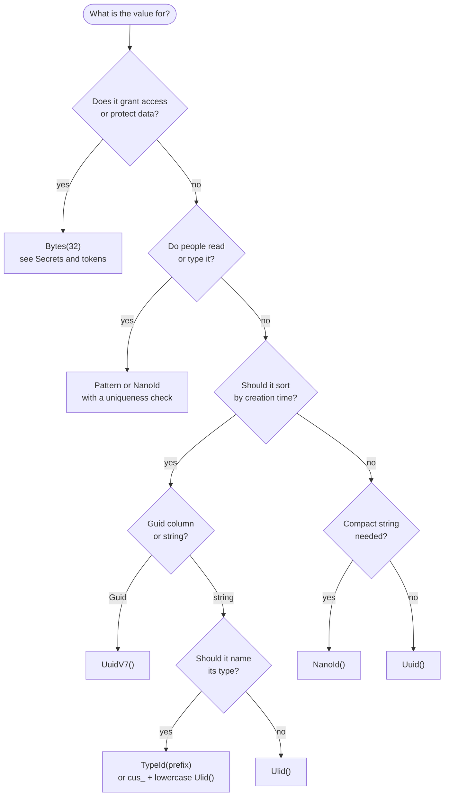

Use this page when you know what the value is for and need the strategy that fits. Start at the flowchart, check the table
for the trade-off, and read the entropy section before shortening anything.

## Decide in four questions



When the value depends on the operation's time, use the context overloads. See [Context-dependent values](context.md).

## Situations and strategies

Random bits are the unpredictable part of each value. Collision figures are in the next section.

| Situation | Code | Example output | Random bits | Trade-off |
| --- | --- | --- | --- | --- |
| Ordinary entity id | `GenerateValue.Uuid()` | `212f34b8-1ff0-4da8-8c22-a43dece95de8` | 122 | The default; reveals nothing, does not sort |
| Id that follows from an input | `GenerateValue.UuidV5(CustomerNamespace, email.ToLowerInvariant())` | `2ed6657d-e927-568b-95e1-2665a8aea6a2` (RFC example below) | 0 | Same input gives the same id; guessable by anyone who knows the namespace and input |
| Index-friendly Guid column | `GenerateValue.UuidV7()` | `01a13571-f1e8-7c3c-8d30-16b90f487b02` | 74 | Appends to B-tree indexes; reveals creation time |
| Sortable string id | `GenerateValue.Ulid()` | `01M4TQ3WF8QS2APSEB06E8VGDK` | 80 | Sorts by age; reveals creation time; not monotonic within a millisecond |
| Self-describing id in logs | `GenerateValue.TypeId("user")` | `user_01m4tq3wf8fs7s4ahqpprc3gt4` | 74 | The prefix names the type; time-ordered |
| Stripe-style public id | `$"cus_{GenerateValue.Ulid().ToLowerInvariant()}"` | `cus_01m4tq3wcw1fn5912rd8rsmgcd` | 80 | Familiar format; prefix and case are plain string work |
| Readable formatted reference | `GenerateValue.Pattern("ORD-[A-HJ-NP-Z2-9]{4}-#{4,6}")` | `ORD-A3K8-12345` | log₂(distinct strings) | Needs a unique constraint or freshness protection; see [Patterns and checksums](patterns.md) |
| Numeric ticket | `GenerateValue.Integer(100000, 999999)` | `483921` | about 19.8 | Inclusive bounds; not a sequence or a high-entropy id |
| Short typed code | `GenerateValue.NanoId(10, "23456789ABCDEFGHJKLMNPQRSTUVWXYZ")` | `SA65PT7D2G` | 50 | No look-alike characters; needs a uniqueness check |
| Compact URL-safe id | `GenerateValue.NanoId()` | `qlBnph5vVBJeX4gbqCwm5` | 126 | 21 characters |
| Token, reset link, API key | `GenerateValue.Bytes(32)` | `gziGp2TEJPHWl6ztCXqiKMj7NVcyO3JhGD7t59Qe204` | 256 | Secret; see [Secrets and tokens](secrets-and-tokens.md) |
| Hex token | `GenerateValue.Bytes(32, ValueEncoding.Hex)` | `45421c194ffabca6…ad8d1d` | 256 | Lowercase hex, 64 characters |
| TOTP secret, key material | `GenerateValue.Bytes(20, ValueEncoding.Base32)` | `PQ5URI2LDHCF6LRMMPYRUPMPRRS5UPGH` | 160 | Case-insensitive, easy to type |
| Time follows the operation | `GenerateValue.TypeId("order", context)` | `order_01j0dy9j4nej4saxp79mmcqts7` | 74 | One captured instant per operation |
| Tenant in the value | `$"{context.Tenant}-{GenerateValue.Ulid(context)}"` | `00000000-…-000000000000-01J0DY9J4N…` | 80 | Rarely needed; namespaces already isolate tenants |

A TypeID's 74 random bits are the UUID v7 bits. The ULID and `cus_` rows differ in encoding from TypeID: a TypeID suffix encodes a UUID v7,
a ULID does not.

## How many random bits you need

Time-ordered ids are unique in practice only because the random part is large enough. The number of values at which the chance of any
collision reaches 1% is about the square root of `2 × 2^bits × ln(1/0.99)`:

| Random bits | Values at 1% collision risk |
| --- | --- |
| 32 | about 9 thousand |
| 40 | about 150 thousand |
| 50 | about 4.8 million |
| 64 | about 600 million |
| 74 | about 20 billion |
| 80 | about 160 billion |
| 122 | about 3 × 10¹⁷ |

- Below 64 bits, generate only with a unique constraint or [freshness protection](/arc/backend/csharp/chronicle/commands/fresh-identifiers/). Reject a collision explicitly; the pattern generator never redraws values to satisfy checksums or domain rules.
- Pattern dates and check digits add no entropy. Mod11 exclusions reduce the admissible population before uniform sampling.
- Size for the total population over the life of the system, not for one request.
- No strategy guarantees uniqueness.

## Derive a stable id from an input

When the same input must give the same id, use `UuidV5` with a fixed namespace per concept.
Keep that namespace unchanged: changing it changes every derived id. For example:

```csharp
using Cratis.Concepts;

public record EmailAddress(string Value) : ConceptAs<string>(Value);

public record CustomerId(Guid Value) : ConceptAs<Guid>(Value)
{
    static readonly Guid CustomerNamespace = new("0f3e1d2c-4b5a-4968-8776-a5b4c3d2e1f0");

    public static CustomerId For(EmailAddress email) =>
        new(GenerateValue.UuidV5(CustomerNamespace, email.Value.ToLowerInvariant()));
}
```

This concept deliberately treats email casing as insignificant. `UuidV5` itself performs no case folding or Unicode normalization.
Its name encoding is UTF-8 without a BOM; unpaired UTF-16 surrogates throw `InvalidUuidV5Name`.
Use an input-taking factory such as `For`, not `IGeneratable<TSelf>.New()`, which takes no input.

The RFC 9562 Appendix A.4 example fixes both inputs and the result:

```csharp
var dnsNamespace = Guid.Parse("6ba7b810-9dad-11d1-80b4-00c04fd430c8");
var id = GenerateValue.UuidV5(dnsNamespace, "www.example.com");
// 2ed6657d-e927-568b-95e1-2665a8aea6a2
```

A derived id does not make a retried command idempotent by itself. You still need a unique constraint or
[freshness protection](/arc/backend/csharp/chronicle/commands/fresh-identifiers/) to reject duplicates.
Anyone who knows the namespace and input can recompute it, so never use it as a secret.

## When not to generate

- **The client supplied the id.** A client-supplied identifier is an input. Keep it; do not replace it with a generated one.
- **The same input must give the same id.** Use `UuidV5` as shown above, or persist and reuse the first id. Random generation creates a different id on retry.
- **The number must be gapless or legal.** Invoice and tax numbering needs an allocator that records every number. Random ids have gaps by design.
- **The value would authorize something.** A generated id identifies; it never proves who is calling. Never use an id as a credential.
- **A secret would come from a time-ordered id.** UUID v7, ULID and TypeID expose creation time and have fewer random bits. Use `Bytes`.

For a dated reference with check digits, use the [context-bearing Pattern overload](patterns.md#fix-dates-to-the-operation).
Use random integers for tickets, not counters: repeated calls may return the same value, and neither strategy allocates a legal invoice sequence.

## Next steps

- [Context-dependent values](context.md) for ids whose time follows the operation.
- [Reference](reference.md) for exact limits and encodings.
