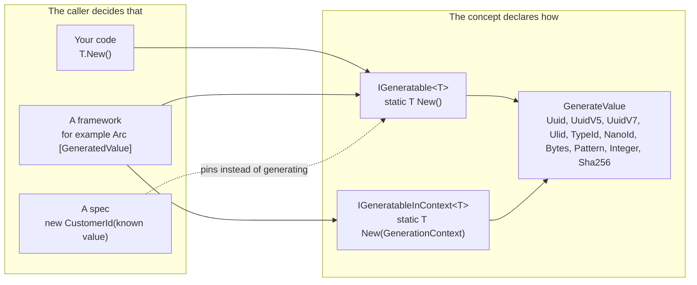

Cratis Fundamentals lets a C# concept declare how to create its own values through a compile-time contract.
Use it when handlers and factories need the same rule for creating an identifier, code or token. The caller asks
for a value without choosing the generation strategy again at every call site.

A concept is a type that wraps a value with domain meaning, such as `CustomerId` instead of a raw `Guid`.
Its `New()` method chooses how to generate that value. Production code can call it when needed, while a spec
can supply a known value and test the behavior without depending on random output.

## The mental model

Implement `IGeneratable<TSelf>` when the concept can generate a value without operation-specific input.
Generic code constrained to `T : IGeneratable<T>` can call `T.New()` without reflection and receive the concept
itself. Implement `IGeneratableInContext<TSelf>` when generation needs the operation's captured time or tenant.

`GenerateValue` supplies the strategies used inside `New()`. Its random strategies draw from a cryptographically
secure random number generator; `UuidV5` and `Sha256` derive deterministic results from supplied input. A fixed
`GenerationContext` fixes the time used by time-bearing strategies, but leaves their random part random.

## What you will be able to do

Start with the [value generation tutorial](tutorial.md) to build shop identifiers, invitation codes and an API key.
You will call the concepts from generic code, then write a spec that fixes the time in an order identifier.
The guides below help you choose a strategy for your own values and handle the result safely.

## Where to go next

| Your situation | Read |
| --- | --- |
| You want to see it working, start to finish | [Tutorial: generate your first values](tutorial.md) |
| You know what you need and want the right strategy | [Choosing a strategy](choosing-a-strategy.md) |
| A value must follow the operation's time or tenant | [Context-dependent values](context.md) |
| A readable reference needs a format, UTC date or check digits | [Patterns and checksums](patterns.md) |
| You are creating tokens, links, API keys or key material | [Secrets and tokens](secrets-and-tokens.md) |
| You need a deterministic fingerprint or a high-entropy token verifier | [SHA-256 digests](sha-256.md) |
| Your specs break because ids are random | [Testing generated values](testing.md) |
| You need exact signatures, limits and encodings | [Reference](reference.md) |

These APIs are in `Cratis.Fundamentals` and target .NET 10 and 11. Concepts themselves are introduced on the [Concepts](../concepts.md) page.
