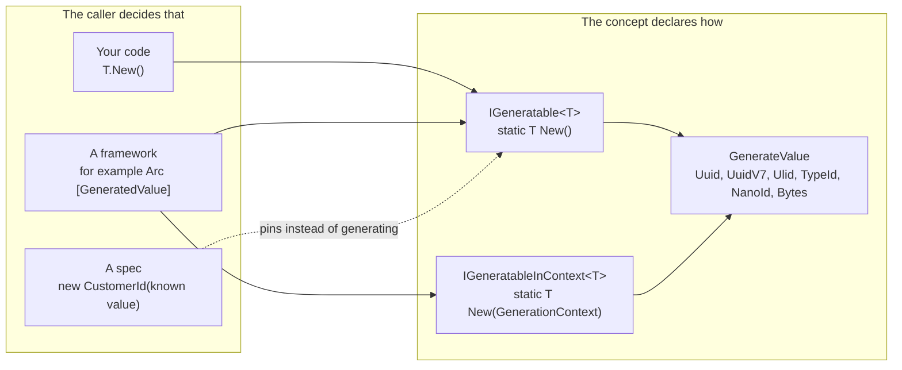

Open a handler in an average codebase and you find `Guid.NewGuid()` next to an invite code built from `System.Random`
and a `New()` method that exists on some identifiers but not others. Each call site decides how a value is made, so
you cannot change the strategy in one place. Generic code cannot ask a type for a fresh value. Specs assert on whatever
a run happened to produce, and on .NET 8 there is no built-in time-ordered UUID at all.

Fundamentals moves those decisions to where they belong. A concept declares *how* its values are made. The code that
needs a value, such as a command pipeline, your own factory or a spec, decides *that* one is needed, and can pin it.

## The mental model

- **One contract, one call.** A concept implements `IGeneratable<TSelf>` and its `New()` makes one call to `GenerateValue`.
- **Generic code needs no reflection.** `T.New()` works on any `T : IGeneratable<T>`, and the result is the concept, not a raw `Guid` or `string`.
- **The caller owns the "when".** Production code generates; a spec supplies a known value or a fixed `GenerationContext`.
- **Secure by default.** Every strategy draws from a cryptographically secure random number generator.

## What you will be able to do

By the end of this section you will:

- make a concept generate its own values and call it from generic code;
- pick between UUID v4, UUID v7, ULID, TypeID, NanoID and random bytes for a stated reason;
- build identifiers whose time part follows the operation, not the clock at each call;
- generate tokens and API keys without leaking them;
- write specs that pin generated values instead of fighting them.

## Where to go next

| Your situation | Read |
| --- | --- |
| You want to see it working, start to finish | [Tutorial: generate your first values](tutorial.md) |
| You know what you need and want the right strategy | [Choosing a strategy](choosing-a-strategy.md) |
| A value must follow the operation's time or tenant | [Context-dependent values](context.md) |
| You are creating tokens, links, API keys or key material | [Secrets and tokens](secrets-and-tokens.md) |
| Your specs break because ids are random | [Testing generated values](testing.md) |
| You need exact signatures, limits and encodings | [Reference](reference.md) |

The section needs `Cratis.Fundamentals` 7.24.0 or later. Concepts themselves are introduced on the [Concepts](../concepts.md) page.
