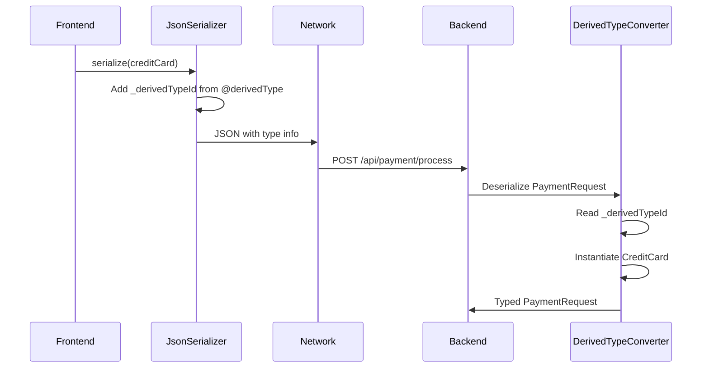
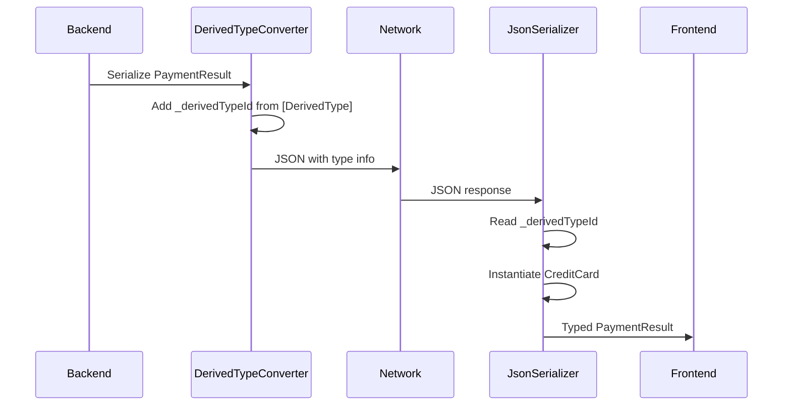

<a id="derivedtypes-integration-backend-and-frontend"></a>

Cratis Fundamentals uses matching derived-type identifiers to reconstruct concrete classes in .NET and TypeScript when a JSON field can hold more than one type. Use this when a payment request declares an `IPaymentMethod`, but the value must arrive as a `CreditCard` or `PayPal` rather than an untyped object.

## Overview

Polymorphic serialization means writing and reading values through a shared interface or base class while retaining their concrete type. The JSON carries `_derivedTypeId`, a property that identifies that type. Each side uses its own registration mechanism to turn the identifier back into a class.

Start by configuring the [.NET derived-type converter](csharp/serialization/derived_types.md) in the options your API actually uses. On the frontend, import the decorated models before deserializing and describe polymorphic fields with `@field`. Matching identifiers connect the registrations; they do not replace either side's setup.

## Shared Concepts

### Target Type Resolution Across Stacks

In .NET, `[DerivedType]` marks the concrete class. The registry selects its single non-system interface as the primary target, unless the attribute supplies an explicit `targetType`. It also registers non-system base classes. Here, non-system means a namespace that does not start with `System`. A class still needs a non-system interface; if it implements several, specify the target explicitly.

In TypeScript, `@derivedType` records the identifier on the concrete class and registers that class against its base classes. The deserializer considers both those runtime registrations and the candidates in `field.derivatives`.

TypeScript interfaces do not exist at runtime. For the `IPaymentMethod` fields below, `@field(Object, false, [CreditCard, PayPal])` supplies the concrete candidates the deserializer needs. A field declared with a base-class constructor can use registered subclasses instead, provided their modules have loaded.

### Unique Type Identifiers

Use the same identifier string for a concrete type on both sides. Here, `"credit-card"` connects the C# attribute to the TypeScript decorator; the class names themselves are not the wire contract:

**Backend (.NET)**:

```csharp
[DerivedType("credit-card")]
public class CreditCard : IPaymentMethod
{
    public decimal Amount { get; set; }
    public string CardNumber { get; set; }
}
```

**Frontend (TypeScript)**:

```typescript
@derivedType('credit-card')
export class CreditCard implements IPaymentMethod {
    @field(Number)
    amount!: number;

    @field(String)
    cardNumber!: string;
}
```

The .NET registry rejects duplicate identifiers across all attributed types in its `ITypes` discovery set, not just types implementing the same interface. Choose stable, descriptive values such as `'credit-card'` and `'paypal'`; a GUID string is also valid. Changing an identifier leaves existing payloads referring to the old value. Constants can reduce repeated literals, but you still need to keep their C# and TypeScript values aligned.

### JSON Wire Format

For a payment-method field, both serializers use this JSON shape. The surrounding API model must use the same property names on each side:

```json
{
  "paymentMethod": {
    "amount": 99.99,
    "cardNumber": "****-1234",
    "_derivedTypeId": "credit-card"
  }
}
```

When reading `paymentMethod`, the .NET converter looks up `"credit-card"` against the declared `IPaymentMethod` target. The TypeScript deserializer looks for it among the field's candidate classes. With both registrations in place, each creates its own `CreditCard` instance. The identifier selects a type; it does not validate the payment data.

## Full-Stack Example

The following excerpts send a payment request to an API and read its response back into TypeScript classes. The controller relies on the models in step 2; `_paymentService`, its injection, and the payment processing are application code omitted here. C# serialization types come from `Cratis.Serialization` and `System.Text.Json`; TypeScript decorators and serialization helpers come from `@cratis/fundamentals`.

### 1. Backend API Endpoint

Configure the ASP.NET Core MVC JSON options used by this controller with `DerivedTypeJsonConverterFactory` and camel-case property names before handling requests. The registry passed to the factory must discover `CreditCard` and `PayPal`. Registering a separate `JsonSerializerOptions` instance does not, by itself, configure MVC; see the [.NET serialization setup](csharp/serialization/derived_types.md#3-configure-json-serialization) for the converter and registry choices.

The POST action receives an `IPaymentMethod` and returns it inside `PaymentResult`. The GET action returns a bare array, which the frontend handles separately below.

```csharp
[ApiController]
[Route("api/[controller]")]
public class PaymentController : ControllerBase
{
    [HttpPost("process")]
    public ActionResult<PaymentResult> ProcessPayment([FromBody] PaymentRequest request)
    {
        // request.PaymentMethod will be properly deserialized to CreditCard or PayPal
        var result = _paymentService.ProcessPayment(request.PaymentMethod);

        return Ok(new PaymentResult
        {
            Success = result.Success,
            PaymentMethod = request.PaymentMethod // Will serialize with _derivedTypeId
        });
    }

    [HttpGet("methods")]
    public ActionResult<IEnumerable<IPaymentMethod>> GetAvailablePaymentMethods()
    {
        return Ok(new IPaymentMethod[]
        {
            new CreditCard { Amount = 0, CardNumber = "Demo" },
            new PayPal { Amount = 0, Email = "demo@example.com" }
        });
    }
}
```

### 2. Shared Models

Keep the request and result shapes aligned across languages. In C#, the declared `IPaymentMethod` properties tell the converter which target to resolve. Both concrete payment classes carry stable identifiers.

Backend models:

```csharp
public interface IPaymentMethod
{
    decimal Amount { get; set; }
}

[DerivedType("credit-card")]
public class CreditCard : IPaymentMethod
{
    public decimal Amount { get; set; }
    public string CardNumber { get; set; }
    public string ExpiryDate { get; set; }
}

[DerivedType("paypal")]
public class PayPal : IPaymentMethod
{
    public decimal Amount { get; set; }
    public string Email { get; set; }
}

public class PaymentRequest
{
    public string OrderId { get; set; }
    public IPaymentMethod PaymentMethod { get; set; }
}

public class PaymentResult
{
    public bool Success { get; set; }
    public IPaymentMethod PaymentMethod { get; set; }
}
```

Frontend models use the same identifiers and camel-case JSON property names. `@field` supplies runtime type information for deserialization. In particular, the derivatives list on `paymentMethod` lets the deserializer choose between `CreditCard` and `PayPal` even though the property is typed as an interface:

```typescript
export interface IPaymentMethod {
    amount: number;
}

@derivedType('credit-card')
export class CreditCard implements IPaymentMethod {
    @field(Number)
    amount!: number;

    @field(String)
    cardNumber!: string;

    @field(String)
    expiryDate!: string;
}

@derivedType('paypal')
export class PayPal implements IPaymentMethod {
    @field(Number)
    amount!: number;

    @field(String)
    email!: string;
}

export class PaymentRequest {
    @field(String)
    orderId!: string;

    @field(Object, false, [CreditCard, PayPal])
    paymentMethod!: IPaymentMethod;
}

export class PaymentResult {
    @field(Boolean)
    success!: boolean;

    @field(Object, false, [CreditCard, PayPal])
    paymentMethod!: IPaymentMethod;
}
```

### 3. Frontend Usage

Serialize the `PaymentRequest` wrapper, not just its payment method, when calling the POST endpoint. Read the response text with `JsonSerializer.deserialize(PaymentResult, ...)` so the nested value is reconstructed using the field metadata rather than left as a plain JavaScript object.

The GET endpoint returns an array without a wrapper. `PaymentMethodList` provides a local field with the candidate derivatives; it does not change the API response format.

```typescript
class PaymentService {
    async processPayment(paymentMethod: IPaymentMethod): Promise<PaymentResult> {
        const request = new PaymentRequest();
        request.orderId = '12345';
        request.paymentMethod = paymentMethod;

        // Serialize with type information
        const json = JsonSerializer.serialize(request);

        const response = await fetch('/api/payment/process', {
            method: 'POST',
            headers: { 'Content-Type': 'application/json' },
            body: json
        });

        const responseJson = await response.text();

        // Deserialize with proper types
        return JsonSerializer.deserialize(PaymentResult, responseJson);
    }

    async getAvailablePaymentMethods(): Promise<IPaymentMethod[]> {
        // The API returns a bare array. Wrap it locally in a model whose field declares
        // the candidate derivatives, so the serializer knows which types to create.
        const response = await fetch('/api/payment/methods');
        const methods = await response.json();

        // Each item is created as CreditCard or PayPal
        return JsonSerializer.deserializeFromInstance(PaymentMethodList, { methods }).methods;
    }
}

// Wrapper model that declares the polymorphic array and its candidate derivatives
class PaymentMethodList {
    @field(Object, true, [CreditCard, PayPal])
    methods!: IPaymentMethod[];
}

// Usage in component
const paymentService = new PaymentService();

// Create a CreditCard payment
const creditCard = new CreditCard();
creditCard.amount = 99.99;
creditCard.cardNumber = '1234-5678-9012-3456';
creditCard.expiryDate = '12/25';

// Process the payment - types are preserved throughout
const result = await paymentService.processPayment(creditCard);

// result.paymentMethod will be a CreditCard instance
if (result.paymentMethod instanceof CreditCard) {
    console.log(`Processed card ending in ${result.paymentMethod.cardNumber.slice(-4)}`);
}
```

## Data Flow

These diagrams follow the payment-method value inside the request and response wrappers. The HTTP calls above still send a `PaymentRequest` and receive a `PaymentResult`.

### 1. Frontend to Backend (Serialization)



### 2. Backend to Frontend (Deserialization)



## Configuration

### Backend Configuration

`DerivedTypeJsonConverterFactory` needs an `IDerivedTypes` registry to resolve identifiers. `Cratis.Json.Globals.JsonSerializerOptions` already includes this factory, so you do not need to add it again. For separately configured options, choose one of the registrations below and pass the resulting options to your serializer calls. For the controller example, apply the converter and naming policy to MVC's JSON options instead.

```csharp
// In Program.cs or Startup.cs
using Cratis.Serialization;

// Explicit registration: use the shared registry
services.Configure<JsonSerializerOptions>(options =>
{
    options.Converters.Add(new DerivedTypeJsonConverterFactory(DerivedTypes.Instance));
    options.PropertyNamingPolicy = JsonNamingPolicy.CamelCase; // Match frontend
});
```

If your application uses convention-based service registration through `AddBindingsByConvention()`, it binds `IDerivedTypes` to `DerivedTypes`. That registry needs an `ITypes` registration, for example from `AddTypeDiscovery()`. Resolve it from the container so the converter uses the same type discovery as your services:

```csharp
using Cratis.Serialization;

services.AddOptions<JsonSerializerOptions>()
    .Configure<IDerivedTypes>((options, derivedTypes) =>
    {
        options.Converters.Add(new DerivedTypeJsonConverterFactory(derivedTypes));
        options.PropertyNamingPolicy = JsonNamingPolicy.CamelCase; // Match frontend
    });
```

The derived-type converter respects `[JsonIgnore]` and `JsonIgnoreCondition`, including `options.DefaultIgnoreCondition`.

### Frontend Configuration

The decorators import their own bundled reflection support, which supplies the metadata APIs when they are missing. An external `import 'reflect-metadata';` is therefore optional for these examples and is not a Fundamentals prerequisite. If you already use that package, import it before your decorated classes.

The flags below show the legacy-decorator configuration used by this repository. Fundamentals also accepts standard decorators, so these flags are not a universal prerequisite. Follow the [field decorator setup](typescript/serialization/field_decorator.md) for the decorator mode your project uses:

```json
// tsconfig.json
{
  "compilerOptions": {
    "experimentalDecorators": true,
    "emitDecoratorMetadata": true
  }
}
```

## Best Practices for Full-Stack Integration

### Prefer Concrete Base Types for Polymorphic Properties

When the domain already has a stable base class, using its constructor in TypeScript field metadata lets registered subclasses supply the candidates. You can avoid repeating a derivatives list on every field, but the subclass modules must still load before deserialization.

There is no need to introduce a base class just for serialization. Interface-shaped models work with explicit frontend candidates, as the payment example shows. In .NET, keep the required non-system interface and specify `targetType` when multiple interfaces make inference ambiguous.

### 1. Synchronized Type Definitions

Keep the two model definitions aligned as the contract changes. If you generate TypeScript from C#, check that the output retains the identifiers and field metadata needed for this round trip:

```typescript
// Consider generating TypeScript models from C# classes
// Or maintain parallel class definitions with identical structures
```

### 2. Consistent Naming Conventions

Match the backend's JSON property names to the decorated frontend fields. Apply the naming policy to the options used by the API; a C# property named `CardNumber` must arrive as `cardNumber` for the TypeScript model below:

**Backend**:

```csharp
options.PropertyNamingPolicy = JsonNamingPolicy.CamelCase;
```

**Frontend**:

```typescript
// Field decorators already use camelCase property names
@field(String)
cardNumber!: string; // Serializes as "cardNumber"
```

### 3. Centralize Type Identifiers (Magic Strings)

When an identifier appears in several places, use constants to reduce repeated literals within each codebase. Keep the C# and TypeScript values equal. These excerpts show only the identifier declarations and registrations; retain the model members from the full example:

**Backend (C#)**:

```csharp
public static class DerivedTypeIds
{
    public const string CreditCard = "credit-card";
    public const string PayPal = "paypal";
    public const string BankTransfer = "bank-transfer";
}

[DerivedType(DerivedTypeIds.CreditCard)]
public class CreditCard : IPaymentMethod { }

[DerivedType(DerivedTypeIds.PayPal)]
public class PayPal : IPaymentMethod { }
```

**Frontend (TypeScript)**:

```typescript
export const DERIVED_TYPE_IDS = {
    CREDIT_CARD: 'credit-card',
    PAYPAL: 'paypal',
    BANK_TRANSFER: 'bank-transfer',
} as const;

@derivedType(DERIVED_TYPE_IDS.CREDIT_CARD)
export class CreditCard implements IPaymentMethod { }

@derivedType(DERIVED_TYPE_IDS.PAYPAL)
export class PayPal implements IPaymentMethod { }
```

Constants do not synchronize the files or prevent two classes from using the same identifier. The .NET registry still checks uniqueness, and your contract checks still need to compare the values used on each side.

### 4. Consistent Naming Conventions

After setting the policy, inspect a payload to confirm the names match. The same setting from step 2 is shown again here: the observable check is that the JSON contains `cardNumber`, not `CardNumber`.

**Backend**:

```csharp
options.PropertyNamingPolicy = JsonNamingPolicy.CamelCase;
```

**Frontend**:

```typescript
// Field decorators already use camelCase property names
@field(String)
cardNumber!: string; // Serializes as "cardNumber"
```

### 5. Error Handling

Handle malformed JSON and conversion failures at the API boundary, but do not treat every unknown identifier as an exception. In TypeScript, an unmatched `_derivedTypeId` falls back to the field's declared type and keeps the identifier on the resulting object. With `Object` as the declared type, that means a plain object rather than a `CreditCard` or `PayPal` instance.

The frontend catch below handles failures that do throw; it does not detect an unresolved derived type:

```typescript
try {
    const result = JsonSerializer.deserialize(PaymentResult, json);
    return result;
} catch (error) {
    console.error('Failed to deserialize payment result:', error);
    // Handle actual failures. An unknown _derivedTypeId alone does not throw: the field's
    // declared type is used and the identifier is kept on the resulting object.
    return null;
}
```

The .NET registry reports an unknown identifier with `MissingDerivedTypeForTargetType`, a direct `Exception` subtype rather than a `JsonException`. The illustrative catch below handles JSON failures, not that registry exception directly. Account for how the registry exception propagates through your API's error handling. A missing `_derivedTypeId` is different again: the derived-type converter returns the target type's default value.

```csharp
try
{
    var request = JsonSerializer.Deserialize<PaymentRequest>(json, options);
    return request;
}
catch (JsonException ex)
{
    _logger.LogError(ex, "Failed to deserialize payment request");
    return BadRequest("Invalid request format");
}
```

### 6. Testing Integration

Check the concrete class and its fields after a round trip. This test sketch uses an application-owned `simulateBackendProcessing` helper: it accepts the serialized card and must return a serialized `PaymentResult` containing that card. For an API integration test, send the `PaymentRequest` wrapper used by `PaymentService` and exercise the actual backend converter. A simulated response alone does not verify the .NET setup.

```typescript
describe('Payment integration', () => {
    it('should handle credit card round-trip', async () => {
        // Create frontend object
        const originalCard = new CreditCard();
        originalCard.amount = 99.99;
        originalCard.cardNumber = '1234';

        // Serialize for backend
        const json = JsonSerializer.serialize(originalCard);

        // Simulate backend processing (you might use a real API in integration tests)
        const backendResponse = await simulateBackendProcessing(json);

        // Deserialize backend response
        const result = JsonSerializer.deserialize(PaymentResult, backendResponse);

        // Verify type preservation
        expect(result.paymentMethod instanceof CreditCard).toBe(true);
        expect((result.paymentMethod as CreditCard).cardNumber).toBe('1234');
    });
});
```

## Common Pitfalls

### 1. Mismatched Type IDs

If a payment method arrives without its expected concrete class, compare `_derivedTypeId` in the payload with both registrations. A C# constant and a TypeScript constant with the same name can still contain different strings.

### 2. Duplicate Magic Strings

Repeated identifier literals make a contract change easy to miss. Use the constants shown above wherever the identifier is reused, and remember that existing stored or in-flight JSON still carries the old value after a rename.

### 3. Missing Derivatives Lists

An interface declaration does not give TypeScript a runtime constructor. Supply derivatives for fields declared with `Object`, as in `PaymentRequest.paymentMethod`. A base-class field can omit the list when its subclasses have registered through `@derivedType` and their modules have loaded.

### 4. Case Sensitivity

If fields are missing after deserialization, compare the payload's property names with the `@field` names. Configure the backend's JSON casing to match them; changing only a TypeScript interface does not rename incoming properties.

### 5. Missing Field Decorators

Serialization writes an object's own properties even when they are not decorated. Typed reconstruction is different: `@field` metadata tells the deserializer which properties to populate and how to convert them, alongside converter and concept handling. Decorate each model property that must be reconstructed as a typed value.

### 6. Type Registration Order

Load the modules containing decorated classes before using those classes for serialization or candidate resolution. An identifier present in a source file is not a runtime registration until the module has executed.

## Debugging

### Backend Debugging

Inspect the same `IDerivedTypes` registry that your converter uses. These checks show whether `CreditCard` was discovered and which primary target it represents; they do not confirm that MVC is using the converter.

```csharp
// Check if a type is registered
var derivedTypes = serviceProvider.GetService<IDerivedTypes>();
var isRegistered = derivedTypes.IsDerivedType(typeof(CreditCard));

// Get target type for derived type
var targetType = derivedTypes.GetTargetTypeFor(typeof(CreditCard));
```

### Frontend Debugging

Check the concrete class's identifier, then inspect the wrapper's field metadata and the outgoing JSON. This separates a missing class registration from a missing derivatives list or a payload without `_derivedTypeId`. Use synthetic payment data for logging, not real card details.

```typescript
// Check derived type registration
const derivedTypeId = DerivedType.get(CreditCard);
console.log('CreditCard ID:', derivedTypeId);

// Check field metadata
const fields = Fields.getFieldsForType(PaymentRequest);
console.log('PaymentRequest fields:', fields);

// Inspect JSON before sending
const json = JsonSerializer.serialize(paymentRequest);
console.log('Outgoing JSON:', json);
```

Once `result.paymentMethod instanceof CreditCard` holds and the expected fields survive the response, check the other payment types and the API's failure cases. For more detail, use the [.NET derived-type guide](csharp/serialization/derived_types.md) for registry setup, the [TypeScript derived-type guide](typescript/serialization/derived_types.md) for runtime candidates, and the [field decorator reference](typescript/serialization/field_decorator.md) for field metadata.
